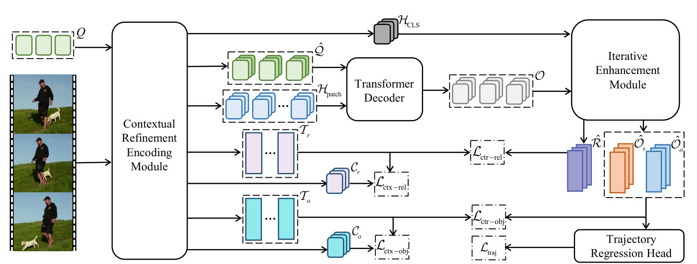

# Pipeline overview

One video in, ranked triplets out. This document is the map; each stage has its
own document with the detail.

Everything below is `--arch metor`. For `--arch metor-compat` the pipeline is
EOV-MMP's, with METOR's modules spliced into the relation classifier — see
[doc 13 §5](13_Iterative-enhancement.md).

---

## 1. The equations, in order

```
Eq.1  (H_CLS, H_patch, T_o, T_r, Q̂, C_o, C_r) = Φ(V, Q)
Eq.2   O                                       = Decoder(Q̂, H_patch)
Eq.3  (Ô_s, Ô_o, R̂)                            = Ψ(O, H_CLS)
Eq.4   S_s, S_o, S_r                           = σ(cos(·, T))
Eq.5   τ_s, τ_o                                = M_b(Ô_s), M_b(Ô_o)
```

In one sentence: *encode the video in a way that also conditions the queries and
the text; decode objects; let objects and relationships improve each other;
score both against the conditioned text; regress the trajectories from the same
features.*

---

## 2. Following the paper's Figure 2



Trace it left to right.

| # | Drawn as | Symbol | Shape | Eq. | Code |
|---|---|---|---|---|---|
| ① | filmstrip, far left | `V` | `(T,3,336,336)` | — | `METORDataset` ([doc 22](22_Data-pipeline.md)) |
| ② | green boxes, top left | `Q` | `(100,256)` | — | [model.py:125](../metor/model.py#L125) |
| ③ | **Contextual Refinement Encoding Module** | `Φ` | — | **1** | built [model.py:129](../metor/model.py#L129), called [model.py:197](../metor/model.py#L197) — [doc 11](11_Contextual-refinement-encoding.md) |
| ④ | green `Q̂` + blue `H_patch` → **Transformer Decoder** | `O` | `(100,T,256)` | **2** | built [model.py:138](../metor/model.py#L138), called [model.py:211](../metor/model.py#L211) — [doc 12](12_Transformer-decoder-and-queries.md) |
| ⑤ | grey `H_CLS` along the top edge | `H_CLS` | `(T,1024)` | — | routed *around* the decoder |
| ⑥ | **Iterative Enhancement Module** | `Ψ` | — | **3** | built [model.py:142](../metor/model.py#L142), called [model.py:221](../metor/model.py#L221) — [doc 13](13_Iterative-enhancement.md) |
| ⑦ | purple `R̂`, orange `Ô_s`, blue `Ô_o` | outputs of `Ψ` | `(P,T,256)` | 3 | — |
| ⑧ | **Trajectory Regression Head** | `M_b` | `(P,T,4)` | **5** | built [model.py:153](../metor/model.py#L153), called [model.py:239](../metor/model.py#L239) — [doc 14](14_Scoring-and-trajectory-heads.md) |
| ⑨ | the five dashed `L` boxes | — | — | **12–16** | [criterion.py:160](../metor/modules/criterion.py#L160) — [doc 15](15_Training-objective.md) |

Two routing details the drawing makes explicit:

- **`H_CLS` bypasses the decoder.** It runs from the CRE module straight across
  the top into the IEM. Only `Q̂` and `H_patch` go through Eq. 2.
- **`C_o` and `C_r` never reach the decoder either.** They leave the CRE module
  only to reach the contextual losses.

### The loss wiring, as drawn

This is the part the prose does not give you — Eq. 12 lists the five terms but
not what each compares. Each dashed `L` box has arrows telling you exactly that:

| Loss box | Arrows into it | Compares | Code |
|---|---|---|---|
| `L_ctr-rel` | `R̂`, `T_r` | predicate scores vs **refined** predicate text | [criterion.py:53](../metor/modules/criterion.py#L53) |
| `L_ctr-obj` | `Ô_s`, `Ô_o`, `T_o` | object scores vs refined object text | [criterion.py:89](../metor/modules/criterion.py#L89) |
| `L_ctx-rel` | `C_r`, `T_r` | context tokens vs the **same** text bank | [criterion.py:139](../metor/modules/criterion.py#L139) |
| `L_ctx-obj` | `C_o`, `T_o` | ditto, object side | same |
| `L_traj` | Trajectory Regression Head | regressed boxes vs ground truth | [criterion.py:106](../metor/modules/criterion.py#L106) |

**`T_o` and `T_r` each have two outgoing arrows** — one to a contrastive loss,
one to a contextual loss. The implementation passes the same tensors to both,
which is what those arrows assert.

---

## 3. Tensor shapes, concretely

For a real VidVRD video at the paper's `--frame_stride 30`. Median video: 7 key
frames. Defaults `N_q = 100`, `d = 256`, `--max_pair_objects 10` → `P = 90`
ordered pairs. VidVRD has 35 object and 132 predicate categories.

| Stage | Symbol | Shape | Notes |
|---|---|---|---|
| input | `V` | `(T, 3, 336, 336)` | T = 7 here |
| ViT patches | `H_patch` | `(T, 576, 1024)` | 24×24 patches, ViT-L width |
| ViT CLS | `H_CLS` | `(T, 1024)` | the "background / whole image" role |
| object context | `C_o` | `(T, 8, 1024)` | 8 tokens — see [doc 31](31_Lineage-evidence.md) |
| relation context | `C_r` | `(T, 8, 1024)` | |
| refined queries | `Q̂` | `(T, 100, 256)` | per frame, Eq. 8 |
| object text | `T_o` | `(35, 768)` | video-conditioned, L2-normalised |
| predicate text | `T_r` | `(132, 768)` | |
| decoded objects | `O` | `(100, T, 256)` | Eq. 2 |
| paired | `O_s`, `O_o` | `(90, T, 256)` | after pair selection ([doc 16](16_Matching-and-pair-formation.md)) |
| enhanced | `Ô_s`, `Ô_o` | `(90, T, 256)` | Eq. 3 |
| relationship | `R̂` | `(90, T, 256)` | |
| predicate scores | `S_r` | `(90, T, 132)` | per timestep — clips get associated later |
| object scores | `S_s`, `S_o` | `(90, 35)` | video-level: a trajectory is one thing |
| trajectories | `τ_s`, `τ_o` | `(90, T, 4)` | normalised `cxcywh` |

Two asymmetries worth internalising, because they are not arbitrary:

- **Predicate scores keep the time axis; object scores do not.** A pair can be
  `walk_past` early and `stand_left` later, so predicates are scored per
  timestep and stitched by the post-processor. A trajectory's *category* does
  not change, so it is pooled over time.
- **Predicates use sigmoid; objects use softmax.** A dog can be simultaneously
  `run_behind` and `larger_than` a person — multi-label. A box is one thing —
  single-label. Eq. 4 writes `σ` for all three; the split is
  [doc 14 §2](14_Scoring-and-trajectory-heads.md).

The `# ---- Eq. N` comments in `metor/model.py` are durable anchors if line
numbers drift: `grep -rn "Eq\. 3" metor/`.

---

## 4. What happens after the model

`--arch metor` **stops here**. There is no evaluation path for it yet — the
vendored post-processing expects tracker-derived trajectories and METOR regresses
its own, so the adapter is unwritten ([doc 32 §2](32_Not-implemented.md)).

`--arch metor-compat` continues through EOV's pipeline, which is complete:

```
clip scores → process_pred  (top-N predicates per clip)
            → association   (stitch equal predicates across adjacent clips)
            → format_       (score = sbj_scr × obj_scr × pre_scr, rank, top 200)
            → vidvrd_eval_api  → mAP, R@50, R@100
```

That lives in [`inference/post_process.py`](../inference/post_process.py) and
[`third_party/vidvrd_eval_api/`](../third_party/vidvrd_eval_api/). The metric is
averaged over the 200 test videos, instance-weighted within each — not
macro-averaged over predicate classes.

---

## 5. About the figures

`docs/figures/*.png` are cropped from the METOR paper, which arXiv publishes
under [CC-BY 4.0](http://creativecommons.org/licenses/by/4.0/) — redistribution
is permitted with attribution:

> Figures 2–4 © Yongqi Wang, Xinxiao Wu, Shuo Yang, *METOR: A Unified Framework
> for Mutual Enhancement of Objects and Relationships in Open-vocabulary Video
> Visual Relationship Detection*, IJCAI 2025.
> [arXiv:2505.06663](https://arxiv.org/abs/2505.06663), CC-BY 4.0.

The PDF itself is **not** in this repository (`.gitignore`) — get it from arXiv.
To regenerate the crops, put it beside this repo as `2505.06663v1.pdf`:

```bash
pip install pymupdf
python - <<'EOF'
import pymupdf
d = pymupdf.open("2505.06663v1.pdf")
crops = {"fig2_framework.png": (2, pymupdf.Rect(50, 44, 566, 240)),
         "fig3_cre.png":       (3, pymupdf.Rect(50, 44, 566, 292)),
         "fig4_iem.png":       (4, pymupdf.Rect(50, 44, 300, 262))}
for name, (page, rect) in crops.items():
    d[page].get_pixmap(dpi=220, clip=rect).save(f"docs/figures/{name}")
EOF
```
