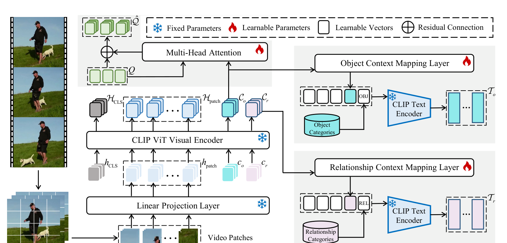

# Φ — Contextual Refinement Encoding

**Paper:** Sec. 3.3, Eq. 6–10 · **File:**
[`metor/modules/contextual_encoding.py`](../metor/modules/contextual_encoding.py)

---

## 1. The problem it solves

CLIP is frozen. Its text embedding for `"zebra"` is the same vector no matter
what video you show it, and so is its embedding for `"walk past"`. In an
open-vocabulary system those embeddings *are* the classifier — the row for a
novel class is computed from the word rather than learned from pixels
([doc 14 §1](14_Scoring-and-trajectory-heads.md)). So a frozen text bank means a
classifier that cannot adapt to what is actually in front of it.

METOR makes both ends of the comparison video-specific. It adds learnable tokens
to the ViT's input, lets them attend over the frame, and uses what comes out to
condition the object queries *and* the class text embeddings.

This is the paper's single largest ablation: removing it (`w/o CRE`) costs
**16.43 → 13.49** novel mAP, more than the iterative enhancement module is worth.

The five equations:

```
Eq. 6   h_patch = L(P(V))                      patchify and project
Eq. 7   (H_CLS, H_patch, C_o, C_r) = V([h_CLS; h_patch; c_o; c_r])
Eq. 8   Q̂  = MHA(Q, C_o, C_o) + Q              refine the object queries
Eq. 9   T_o = G([v_o; M_o(C_o); OBJ])          refine the object text
Eq. 10  T_r = G([v_r; M_r(C_r); REL])          refine the predicate text
```

`V(·)` is the frozen CLIP vision encoder, `G(·)` the frozen CLIP text encoder.
Only `c_o`, `c_r`, `v_o`, `v_r`, `M_o`, `M_r` and the attention in Eq. 8 learn.

---

## 2. Following the paper's Figure 3



The legend, top right, maps straight onto code:

| Symbol | Meaning | In code |
|---|---|---|
| ❄ Fixed Parameters | frozen, never trained | `requires_grad_(False)` |
| 🔥 Learnable Parameters | trained | ordinary `nn.Module` |
| ▢ Learnable Vectors | free parameter vectors | `nn.Parameter` |
| ⊕ Residual Connection | addition | `+` |

What follows traces the figure bottom-left → up → right, the direction the arrows
point. Everything is in `contextual_encoding.py` unless stated.

---

### ① The filmstrip, bottom left — the video

**Drawn as:** three stacked frames, then an arrow down to one frame with a white
grid over it.

The frames arrive as `images`, `(T, 3, 336, 336)`, from
[`data_loading/frame_dataset.py`](../data_loading/frame_dataset.py) —
`METORDataset.__getitem__` reads the key frames and applies CLIP's normalisation.
`T` is the number of key frames, median 7 on VidVRD ([doc 22](22_Data-pipeline.md)).

The grid overlay is the patchification about to happen, not a separate step.

---

### ② "Video Patches" — and why there is no such variable

**Drawn as:** a dashed group of patch thumbnails feeding upward.

**There is no separate patch tensor in the code.** Worth knowing, because you
will go looking for one. CLIP performs patchification *and* projection in a
single strided convolution, so boxes ② and ③ of the figure are one line.

`P(·)` in Eq. 6 is that conv's tiling; `L(·)` is its projection.

---

### ③ "Linear Projection Layer" ❄ — Eq. 6

```python
x = v.conv1(images.type(dtype))                              # (B, width, g, g)
x = x.reshape(x.shape[0], x.shape[1], -1).permute(0, 2, 1)   # (B, N, width)
```

[lines 112](../metor/modules/contextual_encoding.py#L112), in
`ContextTokenInjector.forward`.

| | |
|---|---|
| `v.conv1` | CLIP's own `Conv2d(3, 1024, kernel=14, stride=14)` |
| Output | `(T, 576, 1024)` — 24×24 patches per frame |

The ❄ matters: this is CLIP's projection, frozen at
[line 89](../metor/modules/contextual_encoding.py#L89). We do not train a new one.

---

### ④ The input token row — `h_CLS`, `h_patch`, `c_o`, `c_r`

**Drawn as:** four groups between the projection layer and the ViT, left to right.

| Drawn | Label | What it is | In code |
|---|---|---|---|
| grey stack | `h_CLS` | CLIP's class token | `v.class_embedding`, [line 114](../metor/modules/contextual_encoding.py#L114) |
| dashed pale blue | `h_patch` | the projected patches from ③ | `x` after line 113 |
| cyan stack | `c_o` | **learnable object context tokens** | `self.ctx_obj`, [line 99](../metor/modules/contextual_encoding.py#L99) |
| pink stack | `c_r` | **learnable relationship context tokens** | `self.ctx_rel`, [line 100](../metor/modules/contextual_encoding.py#L100) |

`c_o` and `c_r` are the only *new* things in this entire figure. Everything else
is CLIP. Both are `nn.Parameter(scale * torch.randn(n_ctx, width))`, shape
`(8, 1024)` — the count comes from the predecessors, not the figure
([doc 31](31_Lineage-evidence.md)).

```python
x = torch.cat([cls, x], dim=1)                              # h_CLS ; h_patch
x = x + v.positional_embedding.to(x.dtype)
ctx = torch.cat([self.ctx_obj, self.ctx_rel], dim=0)        # c_o ; c_r
x = torch.cat([x, ctx.unsqueeze(0).expand(b, -1, -1)], dim=1)
```

[lines 116](../metor/modules/contextual_encoding.py#L116). The positional
embedding is added *before* the context tokens are appended, so they carry none —
they are not at a location in the image. PAPER-GAP; standard VPT practice.

---

### ⑤ "CLIP ViT Visual Encoder" ❄ — Eq. 7

```python
x = v.ln_pre(x)
x = x.permute(1, 0, 2)          # NLD -> LND
x = v.transformer(x)            # 24 frozen layers
x = x.permute(1, 0, 2)
x = v.ln_post(x)
```

[lines 125](../metor/modules/contextual_encoding.py#L125).

**This is the mechanism.** The context tokens sit in the same sequence as the
patches, so 24 layers of self-attention let them read the frame *and* let the
frame read them. It is Visual Prompt Tuning on a frozen backbone, and it is why
`--cre_mode pool` (§3) is an approximation rather than an equivalent.

---

### ⑥ The output token row — `H_CLS`, `H_patch`, `C_o`, `C_r`

**Drawn as:** four groups above the ViT, in the *same left-to-right order and
colours* as ④. That is the figure telling you the encoder preserves positions,
which is exactly what the slicing relies on:

```python
n_patch = x.shape[1] - 1 - self.n_ctx_obj - self.n_ctx_rel
h_cls   = x[:, 0]
h_patch = x[:, 1:1 + n_patch]
c_o     = x[:, 1 + n_patch:1 + n_patch + self.n_ctx_obj]
c_r     = x[:, 1 + n_patch + self.n_ctx_obj:]
```

[lines 134](../metor/modules/contextual_encoding.py#L134).

| Symbol | Shape | Goes to |
|---|---|---|
| `H_CLS` | `(T, 1024)` | leaves this figure → the IEM ([doc 13](13_Iterative-enhancement.md)) |
| `H_patch` | `(T, 576, 1024)` | leaves this figure → the decoder ([doc 12](12_Transformer-decoder-and-queries.md)) |
| `C_o` | `(T, 8, 1024)` | ⑦ **and** ⑧ — two arrows leave it |
| `C_r` | `(T, 8, 1024)` | ⑨ |

`C_o`'s fan-out is Eq. 8 and Eq. 9 sharing one source.

`H_patch` comes back in ViT *width* (1024), not the projected 768 — that is what
a detector consumes, and it matches what `patch_` is in the EOV path.

---

### ⑦ "Multi-Head Attention" 🔥 and the ⊕ — Eq. 8

**Drawn as:** `Q` (green) enters from the left, an arrow rises from `C_o`, the
output meets a ⊕ that also takes `Q`, and the result is `Q̂` (green, top).

```python
kv = self.ln_kv(self.ctx_proj(ctx_obj.to(queries.dtype)))
out, _ = self.attn(self.ln_q(queries), kv, kv, need_weights=False)
refined = out + queries                          # the ⊕
```

| | |
|---|---|
| Class | `ObjectQueryRefiner`, [line 176](../metor/modules/contextual_encoding.py#L176) |
| Body | [lines 209](../metor/modules/contextual_encoding.py#L209) |
| `Q` | `METOR.query_embed.weight`, `(100, 256)` — [model.py:125](../metor/model.py#L125) |
| `Q̂` | `(T, 100, 256)` |

The ⊕ is drawn because it matters. The paper argues for it explicitly: the
residual "preserves information in the original object queries while
incorporating contextual knowledge". Removing this refinement is their `w/o CRQ`
ablation, 16.43 → 15.32 novel mAP.

**The output projection is zero-initialised**, so an untrained refiner is exactly
`Q̂ = Q`. The decoder is meant to be COCO-pretrained; a random refiner would
corrupt its queries on step 0. Pinned by
`test_query_refiner_starts_as_the_identity`.

---

### ⑧ The object text branch — Eq. 9

**Drawn**, left to right along the upper grey panel:

`C_o` → **Object Context Mapping Layer** 🔥 → drops into a dashed prompt row
`[▢][▢][▢] [cyan] [OBJ]` ← fed also by an **Object Categories** cylinder →
**CLIP Text Encoder** ❄ → `T_o`, tall cyan bars.

| Figure element | Symbol | In code |
|---|---|---|
| Object Context Mapping Layer 🔥 | `M_o` | `ContextMappingLayer`, [line 218](../metor/modules/contextual_encoding.py#L218); applied [line 371](../metor/modules/contextual_encoding.py#L371) |
| white boxes ▢ | `v_o` | `self.prompt_vectors`, `nn.Parameter(8, 768)` |
| the cyan box in the row | `M_o(C_o)` | `mapped`, line 371 |
| `[OBJ]` | the category token | `self.token_suffix` (class name + EOS) |
| Object Categories cylinder | the 35 class names | passed to `RefinedTextEncoder.__init__` |
| CLIP Text Encoder ❄ | `G(·)` | `self._encode`, [line 348](../metor/modules/contextual_encoding.py#L348) |
| `T_o` | refined object text | `(35, 768)`, L2-normalised |

```python
learnable = torch.cat([self.prompt_vectors, mapped], dim=0)   # [v_o ; M_o(C_o)]
prompts = torch.cat([self.token_prefix,      # [SOS]
                     learnable,              # ▢▢▢ + cyan
                     self.token_suffix],     # class name + [EOS]
                    dim=1)
```

[lines 376](../metor/modules/contextual_encoding.py#L376). One prompt per
category, so the output is `(n_classes, d)` — a classifier whose rows are
computed from *words* and from *this video*. That is the whole mechanism.

The white-box count is schematic: three drawn, eight used. The same figure draws
five boxes for 576 patches.

---

### ⑨ The relationship text branch — Eq. 10

Structurally identical, one panel lower, in pink: `C_r` → **Relationship Context
Mapping Layer** 🔥 → `[▢][▢][▢] [pink] [REL]` ← **Relationship Categories** →
**CLIP Text Encoder** ❄ → `T_r`, `(132, 768)`.

Both branches are the same class constructed twice, at
[line 446](../metor/modules/contextual_encoding.py#L446):

```python
self.obj_text = RefinedTextEncoder(clip_model, obj_classnames, ..., token_position="end")
self.rel_text = RefinedTextEncoder(clip_model, rel_classnames, ..., token_position=rel_token_position)
```

#### Where the category token sits — settled by this figure

Read the drawn prompt rows carefully: both end `… [OBJ]` and `… [REL]`. The
category token is **last**, matching Eq. 9 and Eq. 10 as printed.

This **contradicts both predecessors**, which put the relationship token at 75%
of the token length (MMP: *"The [CLS] token is positioned at 75% of the token
length"*; EOV-MMP: *"positioning the relationship token [REL] at 75% of the
token length"*, keeping `[OBJ]` at the end). METOR changed it, and its figure
and its equation agree.

| `--rel_token_position` | Layout | Support |
|---|---|---|
| `end` (default) | `[…learnable…] [REL]` | Eq. 10 **and Figure 3** |
| `three_quarter` | 75% learnable, `[REL]`, rest | MMP and EOV-MMP, *not* METOR |

So the default is right, and `three_quarter` is retained only to test the
predecessors' variant. This was logged as an open ambiguity until the figure was
read — a useful reminder that lineage evidence is a prior, not proof
([doc 31 §3.3](31_Lineage-evidence.md)).

Implementation note: the `three_quarter` branch at
[line 390](../metor/modules/contextual_encoding.py#L390) has to splice per class,
because class names differ in token length so the insertion point moves.

---

### What leaves this figure

All seven outputs are the return value of `Φ`, i.e. Eq. 1 —
[`ContextualRefinementEncoder.forward`, line 464](../metor/modules/contextual_encoding.py#L464),
called at [model.py:197](../metor/model.py#L197).

| Symbol | Consumer |
|---|---|
| `Q̂`, `H_patch` | Transformer decoder, Eq. 2 |
| `H_CLS` | Iterative Enhancement Module, Eq. 3 |
| `T_o`, `T_r` | scoring (Eq. 4) **and** the contextual losses (Eq. 16) |
| `C_o`, `C_r` | the contextual losses, Eq. 16 |

---

## 3. Two ways to get the context — and they are not equivalent

| | `--cre_mode inject` | `--cre_mode pool` |
|---|---|---|
| What | really appends tokens to the ViT input, as ④–⑥ above | attention-pools *cached* patch embeddings |
| Faithful to Eq. 7 | yes | **no** — an approximation |
| Cost | a ViT-L forward+backward per frame per step | negligible |
| Default for | `--arch metor` | `--arch metor-compat` |
| Class | `ContextTokenInjector` [line 70](../metor/modules/contextual_encoding.py#L70) | `PooledContextEncoder` [line 142](../metor/modules/contextual_encoding.py#L142) |

In `pool` mode the context tokens see the patches, but the patches never see the
context tokens, and the interaction happens once instead of being iterated
through 24 layers. It exists because it can be trained on pre-extracted features,
which is the only regime a small machine can afford ([doc 40](40_Hardware.md)).

**Any number produced with `pool` must say so.** It is a different model.

---

## 4. Ablation switches

`ContextualRefinementEncoder` ([line 409](../metor/modules/contextual_encoding.py#L409))
applies these:

| Flag | Effect | Paper |
|---|---|---|
| `--no_crq` | skips ⑦; `Q̂ = Q`, and the refiner is not constructed at all | Table 3 `w/o CRQ` |
| `--no_crt` | skips ⑧⑨; `T_o`/`T_r` fall back to fixed CLIP prompts | Table 3 `w/o CRT` |
| both | — | Table 3 `w/o CRE` |

The refiner is *absent*, not bypassed — a present-but-unused module would still
take optimiser state and confuse a parameter count.

---

## 5. The one thing that can silently break

`c_o` and `c_r` are new inputs to a *frozen* encoder. If they get detached,
appended after the transformer instead of before, or otherwise disconnected from
the graph, then:

- the model still builds,
- the forward pass still returns correct shapes,
- training still runs and the loss still decreases,
- and the contextual refinement **learns nothing at all**.

Nothing else in the test suite would notice. Hence
`test_context_tokens_receive_gradient_through_the_frozen_vit`, which asserts a
non-zero gradient on both parameters after a backward. If you change anything in
this file, that is the test to watch ([doc 41 §2](41_Testing.md)).

---

## 6. Still open

Recorded in [doc 30 §1](30_Paper-gaps.md):

- **Is `C_o` per-frame or video-level in Eq. 9–10?** Eq. 8 says explicitly "in
  each frame"; Eq. 9–10 say nothing. Here: per-frame for queries, pooled for
  text — the only reading under which both type-check, since a text classifier
  that changed every frame could not be compared against a video-level object
  score in Eq. 4. See [line 359](../metor/modules/contextual_encoding.py#L359).
- **Positional embedding on the appended tokens:** none (④).
- **Token counts:** 8 and 8, from the predecessors, not from the figure.

Closed by the figure: the `[REL]` position (⑨).
