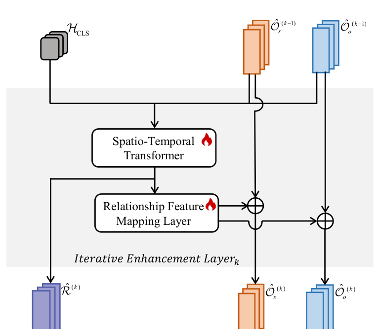

# Ψ — Iterative Enhancement

**Paper:** Sec. 3.4, Eq. 3 and 11 · **File:**
[`metor/modules/iterative_enhancement.py`](../metor/modules/iterative_enhancement.py)

This is the paper's headline contribution — the thing that makes the framework
"mutual" rather than a cascade. §3 contains a property of it that the paper does
not mention and that you should know before attributing results to it.

---

## 1. The equations

```
Eq. 3   (Ô_s, Ô_o, R̂) = Ψ(O, H_CLS)

Eq. 11  R̂⁽ᵏ⁾   = STTrans⁽ᵏ⁾([Ô_s⁽ᵏ⁻¹⁾; Ô_o⁽ᵏ⁻¹⁾; H_CLS])
        Ô_s⁽ᵏ⁾ = α·Ô_s⁽ᵏ⁻¹⁾ + (1−α)·M_f⁽ᵏ⁾(R̂⁽ᵏ⁾)
        Ô_o⁽ᵏ⁾ = α·Ô_o⁽ᵏ⁻¹⁾ + (1−α)·M_f⁽ᵏ⁾(R̂⁽ᵏ⁾)
```

One layer, two directions:

1. **objects → relationship.** The subject, the object and the scene are read
   together to form a relationship representation.
2. **relationship → objects.** That representation is blended back into both
   object features.

Stack `N_i` of them and the two keep improving each other. `α = 0.9`, so each
layer moves the object features by only 10% — deliberately gentle, and
consistent with the paper's Table 4 saturating at two layers.

Initialised with `Ô⁽⁰⁾ = O`; the outputs are the last layer's.

---

## 2. Following the paper's Figure 4



The grey panel is **one** layer `k`; `N_i` of them are stacked. Trace it top to
bottom.

---

### ①②③ The three inputs

**Drawn as:** a grey stack `H_CLS` top left, an orange stack `Ô_s⁽ᵏ⁻¹⁾`, a blue
stack `Ô_o⁽ᵏ⁻¹⁾`. All three feed the transformer together — `H_CLS` is not
injected later.

| Drawn | Symbol | Shape | In code |
|---|---|---|---|
| grey | `H_CLS` | `(T, d)` | `cls_feat`, projected from ViT width at [model.py:222](../metor/model.py#L222) |
| orange | `Ô_s⁽ᵏ⁻¹⁾` | `(P, T, d)` | `obj_s` |
| blue | `Ô_o⁽ᵏ⁻¹⁾` | `(P, T, d)` | `obj_o` |

They are stacked into the role triple at
[line 165](../metor/modules/iterative_enhancement.py#L165):

```python
tokens = torch.stack([obj_s, obj_o, cls_feat], dim=2)    # (P, T, 3, d)
```

The role set — subject, object, and the whole image as "background" — is not a
guess; EOV-MMP names exactly those three ([doc 31](31_Lineage-evidence.md)).

---

### ④ "Spatio-Temporal Transformer" 🔥 — Eq. 11, line 1

`SpatioTemporalTransformer`,
[line 48](../metor/modules/iterative_enhancement.py#L48). Input `(P, T, 3, d)`,
output `(P, T, d)`. It runs:

1. **spatial** attention across the 3 roles, per timestep — the only place the
   relation can actually be formed;
2. **temporal** attention across the T timesteps, per role — where `walk_past`
   becomes distinguishable from `stand_left`;
3. **concatenate the 3 roles and project** back to `d`.

None of that is guesswork either. EOV-MMP states the same design:

> "To reduce the computational complexity, we decouple the spatio-temporal
> modeling into separate and successive modules, namely spatial modeling and
> temporal modeling."

and its Eq. 24 concatenates before projecting: `ṽ = ψ([v̈_s; v̈_o; v̈_h])`.
Embeddings follow the same source — a **role** embedding shared across frames, a
**temporal** embedding shared across roles.

---

### ⑤ `R̂⁽ᵏ⁾` — and where it branches off

**Drawn as:** a purple stack at the bottom left, fed by a line that leaves the
path **above** the mapping layer.

That placement is the point: the relationship feature that gets *scored* is the
raw transformer output, **not** the mapped one. `M_f` exists only to feed the
objects. `rel` in code, `(P, T, d)`.

---

### ⑥ "Relationship Feature Mapping Layer" 🔥 — Eq. 11, lines 2–3

`self.mapping`, an MLP at
[line 147](../metor/modules/iterative_enhancement.py#L147).

Its final linear is **zero-initialised**, so an untrained layer contributes
nothing beyond the `α` rescale rather than injecting noise into
(COCO-pretrained) object features on step 0. The paper does not say; this is the
standard adapter choice, pinned by
`test_zero_initialised_mapping_starts_as_pure_alpha_rescale`.

---

### ⑦ The two ⊕ nodes — the blend

```python
mapped = self.mapping(rel)
new_s = self.alpha * obj_s + (1.0 - self.alpha) * mapped
new_o = self.alpha * obj_o + (1.0 - self.alpha) * mapped
```

[line 171](../metor/modules/iterative_enhancement.py#L171).

**Look carefully at the drawing: there is exactly ONE mapping layer, with two
arrows out of it — one into each ⊕.** Both object paths receive the identical
tensor. That is not an artefact of how the equations were read; the figure draws
it. It is what produces the property in §3.

`--residual_mapping` offers the other reading — `M_f` predicting a *delta* —
which starts as the exact identity and tends to train more stably. It is **off
by default** and labelled a DEVIATION, because it changes that algebra.

---

### ⑧ The outputs

Orange `Ô_s⁽ᵏ⁾` and blue `Ô_o⁽ᵏ⁾` at the bottom, plus purple `R̂⁽ᵏ⁾` from ⑤.
After `N_i` layers these become `Ô_s`, `Ô_o`, `R̂` of Eq. 3 —
`IterativeEnhancementModule`,
[line 181](../metor/modules/iterative_enhancement.py#L181).

---

## 3. A property of Eq. 11 the paper does not mention

Both object features receive the **same** additive term `M_f(R̂)` — ⑦ above.
Subtract the second line of Eq. 11 from the third:

```
Ô_s⁽ᵏ⁾ − Ô_o⁽ᵏ⁾ = α · (Ô_s⁽ᵏ⁻¹⁾ − Ô_o⁽ᵏ⁻¹⁾)
```

The subject–object **difference is only ever scaled by `α`, never rotated**.
After `N_i` layers it is the original difference times `α^N_i` — at the paper's
`α = 0.9`, `N_i = 2` that is 0.81, while the shared component grows.

In plain terms: **the module cannot change how a subject differs from its
object.** It can only translate the pair together toward whatever the relation
says they both are, while pulling them slightly closer to each other.

Verified in closed form by
`test_paper_literal_update_scales_subject_object_difference_by_alpha`, and
confirmed as *intended* by Figure 4's single shared mapping layer.

Why it matters: nothing in the paper's ablations distinguishes "mutual
enhancement" from "a smoothing prior over the pair". Table 4 varies `N_i`, which
varies the amount of smoothing at the same time as the amount of enhancement.
Worth knowing before quoting the +1.6 ([doc 33 §3](33_Verification-status.md)).

---

## 4. `N_i` and the ablation

Sec. 4.2: **2 for VidVRD, 3 for VidOR.** Their Table 4:

| `--n_iter` | Novel mAP |
|---|---|
| 0 | 15.16 |
| 1 | 16.04 |
| **2** | **16.43** |
| 3 | 16.25 |

`--n_iter 0` is a legal and meaningful setting, not a degenerate one: it forms
the relationship features once with **no feedback into the objects**. That is
their Table 4 baseline and the only clean comparison point for what the module
buys.

Note the same VidVRD-vs-VidOR pattern in the lineage: EOV-MMP and MMP both use
one spatio-temporal block for VidVRD and two for VidOR. METOR uses 2 and 3. The
"+1 for VidOR" habit is consistent across all three papers.

---

## 5. In `--arch metor-compat`

The module is spliced into EOV-MMP's relation classifier rather than into a
METOR decoder — [`metor/compat.py`](../metor/compat.py), class
`METORFeatEmbedding` at [line 52](../metor/compat.py#L52).

EOV represents each clip as **four** 768-d region vectors (subject box, object
box, union box, whole frame) and its predicate classifier is four text
embeddings side by side, so that structure cannot be disturbed without
invalidating the released weights. The insertion respects it:

| EOV slot | Used as |
|---|---|
| 0 — subject region | `O_s` of Eq. 11 |
| 1 — object region | `O_o` of Eq. 11 |
| 3 — whole frame | `H_CLS` of Eq. 11 |

and the outputs are written back in place: enhanced objects to slots 0 and 1,
`R̂` added into slot 2 (the union region, where the relation already lives in
EOV's design). Shapes are unchanged end to end.

**`--n_iter 0` means "EOV untouched"** in compat mode — no module, no
parameters, no change to the forward pass — which is what makes the delta
attributable. That differs from the paper's own Table 4 row 0, and the
distinction is deliberate; conflating them would destroy the measurement. Pinned
by `tests/test_compat_equivalence.py`.
