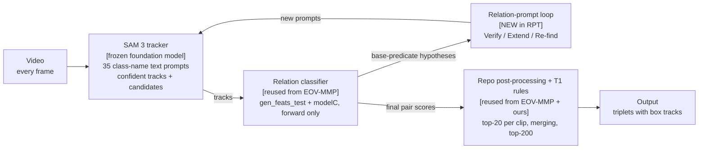

# Proposal: Relation-Prompted Foundation Tracking for Ov-VidVRD

Version 5 · 2026-10-26 · Bùi Trường Giang · revised after `claude/rpt-review-3.md` and the repo merge (`claude/repo-layout.md`)

## Changes in version 5 (after review 3)

| # | Source | Change in this version |
|---|---|---|
| 1 | Fix 1: loop-added track scores | Loop-added track score = min(its own mean SAM 3 score, the confident cut). The old rule held for Verify, but not for Re-find, whose exemplar-found tracks can score above the cut. Wording changed from "cannot outrank" to "are down-weighted relative to confident tracks" (3.4, 7). |
| 2 | Fix 2: shuffled control | Defined exactly (3.3), with the same caps and a fixed, reported seed. It is used in G2 and in test row h (6). |
| 3 | Answer 1 | The box-sensitivity margin stays at 5 points of top-5 hit rate. |
| 4 | Answer 2 | The cap fraction is a fixed 0.2, written now, not derived from data. G1 and G2 report track growth per video, binned by confident track count *N* (3.3, 6). |
| 5 | Answer 3 | All nine test rows kept. Row i runs SAM 3 on the GT-derived range itself, not on cropped whole-video tracks. The real runs are listed (6). |
| 6 | Next step | G0 goes to Claude Code (prompt delivered separately). |
| 7 | Repo merge (26 Oct) | All work lives in `~/Documents/thesis/source/ov-vidvrd-lab`. RPT code goes in `studies/rpt/`. The authors' files from `fdeeeb4` are never edited, and pushing is blocked. The RPT amendment extends the chain head after A26m, `ac77e243…a591` (4, 6). |
| 8 | Chain checker | `studies/migration/verify_after_A26m.py` is the checker; the old `verify_chain.py` fails by design. Before the RPT amendment pins it, its ov-pairtime check must read from the archive bundle (`ov-pairtime-2026-10-24-a820a0e.bundle`) or fail loudly. Today it skips silently, because the folder is gone. Done in G0 (6). |
| 9 | A26 upload | A26's GPU upload script now points at this repo, with the authors' code at the root. Because A26 is folded into the RPT test session, the script is re-pointed and re-pinned in the RPT test amendment (6). |

## Changes in version 4 (after review 2 and its correction)

| # | Source | Change in this version |
|---|---|---|
| 1 | Correction: bars | **METOR 16.74 / 27.52 is the only bar.** OpenVidVRD 17.95 / 28.48 is listed for completeness, marked "arXiv only, no venue, no code, not reproducible", and is not a target. Decomposed Prompt's 19.90 is a RelDet score, a different task, and is removed as a bar (sections 1, 5, 7, 9). The "protocol F" column and the optional MEGA-tracklet row are dropped. Working target: about 17.7. |
| 2 | Correction: supervisor | The question is now: *"Is a disclosed SAM 3 front end acceptable for comparison with METOR on SGDet?"* Ask it now. It does not block G0 or G1, but it does block G2 and the test session. |
| 3 | A1, gap rule | One SAM 3 ID = one track. Internal gaps are filled the way the released track code does. A track is split only when SAM 3 itself assigns a new ID (3.1, 3.2). |
| 4 | A2, false-track burden | G1 now reports tracks, unmatched tracks and candidate pairs per video. New pass bar: unmatched confident tracks per video ≤ 1.5× EOV-MMP's (6). |
| 5 | A3, box sensitivity | Uses top-5 hit rate, adds EOV-MMP's own detector boxes as a third arm, and becomes a secondary bar (6). |
| 6 | A4, score field | SAM 3's own per-object confidence, averaged over detected frames only (3.4). |
| 7 | B1, G2 is in-sample | G2 on HELD is kill-only. The shuffled-score loop moves into the test session as its own configuration (6). |
| 8 | B2, caps | Caps scale with each video's confident track count and are fixed from FIT annotation statistics before any SAM 3 run (3.3). |
| 9 | B3, comparisons | One primary row (RPT + T1, whole video) and one primary comparison (vs R0w + T1). The GT-range row is the like-for-like METOR comparison. Both splits are reported (6). |
| 10 | B4, object type | The gain is split into relations with a novel-class object and relations with base-class objects only (4, 6). |
| 11 | B5, keep weight | Dropped. Loop-added tracks keep their own mean SAM 3 score (3.4). |
| 12 | B6, v2 | v2 uses RB1's fixed, clean step-4 code (R2-style), not the released code (3.4, 4). |
| 13 | C, smaller points | Upstream share restated (61.6% is U1–U3, with U3 shown). The "12 points" claim is reworded as unexplained. G0 adds an end-to-end run on 2–3 HELD videos and adapter unit tests. Window joining is checked. A runtime fallback is pre-registered. |
| 14 | D, open questions | All seven answered (section 9). |

Earlier versions: v2 applied review 1; v3 applied the read-only code check (`code_check.md`).

## 1. Summary

**Claim.** Ov-VidVRD models should not learn to find objects from 800 videos. They should ask a frozen foundation tracker for objects, and use their own relation hypotheses to decide what to ask for.

**Framework (working name: RPT, Relation-Prompted Tracking).** It has three parts:

1. a frozen promptable tracker, SAM 3;
2. a relation core, EOV-MMP's relation classifier, run forward-only;
3. a loop in which relation hypotheses send new prompts to the tracker, to recover objects and tracks the first pass missed.

**Why now.** 61.6% of SGDet novel misses happen before any relation is scored (U1–U3, D1). EOV-MMP and METOR both train object finding on VidVRD's 800 videos and 35 classes. SAM 3 (November 2025) gives open-vocabulary detection plus tracking from text prompts.

**Bar.** METOR (IJCAI 2025) is the only bar: **16.74 novel / 27.52 all**, SGDet. The realistic range for RPT is about 17.3–18.2 novel; the working target is about 17.7, clearly above METOR. OpenVidVRD (17.95 / 28.48) is listed for completeness only: arXiv only, no venue, no code, not reproducible.

**Supervisor question (ask now).** *"Is a disclosed SAM 3 front end acceptable for comparison with METOR on SGDet?"*
- What is known: the supervisor requires a method that beats the current state of the art, and named METOR's numbers (16.74 novel / 27.52 all) as the target.
- What is not known: the supervisor's view on foundation models.

The answer does not block G0 or G1. It must arrive before G2.

**Cost to the test session:** about $20–34 and 5–6 weeks. G1 alone can kill the idea for under $5.

## 2. Motivation

The largest measured loss is upstream: objects are never found, so no relation can be scored. Every post-hoc idea on the frozen checkpoint has now been tried and is close to exhausted (`stage2-results.md`).

**Where SGDet novel misses go (D1, 484 missed GT):**

| Bucket | Missed GT | Share | Addressed by RPT? |
|---|---:|---:|---|
| U1, no matching track pair | 262 | 54.1% | yes, the main target |
| U2, wrong object name | 34 | 7.0% | yes; 51 of 54 class mismatches involve a novel object class |
| U3, pair not scored | 2 | 0.4% | indirectly |
| **Upstream, U1–U3** | **298** | **61.6%** | |
| C1, run continues past the GT (over-long) | 129 | 26.7% | no; separate fix (section 7) |
| C1, boxes off | 21 | 4.3% | partly, through better boxes |
| C1, truly not seen | 20 | 4.1% | no |
| A1, lost after scoring | 8 | 1.7% | no |
| N1, near miss | 8 | 1.7% | no |

**Inside U1 (D2, 262 GT):**
- no box even at score 0.05: 35.5%;
- box below the 0.35 cut: 36.6%;
- removed by the length filter: 14.5%;
- lost in tracking: 11.1%.

Tracklet keeping can only reach the last three. A different detector is the only way to reach the first.

**Headroom (Q7).** Perfect tracks and names recover about 41% of U1 relations. SGDet novel recall would go from 20.0% to at most 37.8%. PredCls novel is 21.70 (22.25 with T1 rules), against SGDet 15.79.

**Why a framework, not another component.** Every component tried so far sat inside EOV-MMP's pipeline and inherited its object finding. A framework paper needs one diagnosis and a design that follows from it. METOR's diagnosis was error propagation in a cascade. This proposal's diagnosis is measured: object finding learned from a small benchmark is the bottleneck.

**Why not a from-scratch unified model.** OV-PairTime's clean stack reached 9.9 novel PredCls, against EOV-MMP's 21.65. About 12 points separate the two stacks, and the cause has not been separated. Candidates: prompt tuning, 640 vs 800 training videos, and the training leaks. Either way, a from-scratch model starts in that hole. RPT keeps EOV-MMP's relation weights and changes only how objects are found.

## 3. Framework

RPT replaces EOV-MMP's detector, tracker, track filter and class-score fusion with a frozen SAM 3. It keeps EOV-MMP's relation classifier unchanged, and adds a loop in which the classifier's hypotheses drive new prompts. Version 1 trains nothing; every rule is fixed before any test run.

The loop is the only new part. SAM 3 runs frozen, EOV-MMP's relation classifier runs forward-only, and no METOR component is used.

### 3.1 Part A: tracker (frozen SAM 3)

- **Input:** every frame of the whole video. This drops the GT-derived frame range used by the released SGDet path; the GT-range run is kept as a separate, labelled row (section 6).
- **Prompts:** the 35 VidVRD class names, one text prompt each. Wording is fixed in advance; any synonym (for example for `watercraft`) is pre-registered, never tuned.
- **Output:** masklets with persistent IDs and per-frame scores. Each becomes a box trajectory (the tight box around the mask).
- **Identity (A1).** One SAM 3 ID is one track. RPT never splits a masklet by its own gap rule, because splitting throws away the identity SAM 3 kept through an occlusion. Splits would also re-create fragmentation, which the evaluator punishes: vIoU is computed over the whole trajectory, so a relation spanning the gap would become two half-predictions, each of which can fail vIoU 0.5. EOV-MMP's tracks are rarely fragmented (3.95%). A track ends only when SAM 3 itself assigns a new ID.
- **Duplicates across prompts:** the same object can be found under two names (giant_panda and red_panda, cattle and horse). Masklets that overlap above a fixed mask IoU are merged. The name with the higher score wins.
- **Two tiers (D3).** The confident cut is SAM 3's documented default threshold. The candidate floor is fixed at 0.1, mirroring the earlier tier-2 plan. Masklets between the two are *candidates* for the loop. With strict caps, the floor matters little.
- **Runtime fallback (pre-registered).** If G1's runtime bar fails, text detection runs every *k* frames, with SAM 3's tracker propagating in between. *k* is fixed in the amendment and never tuned on results.

**Rules RPT replaces** (code check, rules 1–9; all come before `gen_feats_test`):
1. the frame range taken from the GT trajectories' extent;
2. the 0.35 query cut, with the single best query as fallback;
3. dedupe at IoU 0.8;
4. per-class score fusion with modelB (0.6/0.4 for six novel classes, 0.3/0.7 for the rest, one class unfused);
5. deep_sort (every confidence fixed at 1) with AFLink;
6. AFLink's thresholds;
7. the IoU-0.5 score transfer to track frames;
8. the track format rules: coverage ≥ 65%, gap trim, ≥ 10 frames, argmax class, NaN score when no frame was scored;
9. the 15% rule.

**Rules RPT keeps** (rules 10–12, plus the score formula in 3.4):
- pairs overlap ≥ 10 frames, 30-frame clips, the tail rule, ≤ 40 clips;
- the top 20 predicates per clip;
- greedy merging of consecutive clips with the same predicate, then the top 200 per video.

### 3.2 Part B: relation core (EOV-MMP, forward-only)

- **Entry point (confirmed).** The released repo has no PredCls path. The relation head runs on given tracks through `gen_feats_test(...)` (`models/gen_labels.py:642`), then `modelC` (`end2end_model.py:326-337`). Session 3's PredCls fed GT tracks into exactly this (`stage1c/cache_wrapper.py:184-191`). SAM 3 tracks enter the same way.
- **Embeddings (confirmed).** For each 30-frame clip, at its middle frame, the function takes a masked mean over the frozen TagCLIP projected patch grid for the subject, object and union boxes, plus the global frame embedding. Geometry features come from the boxes alone. `pred_embed` never reaches modelC, so SAM 3 boxes go through the same function unchanged.
- **No class information enters the features.** A track's name is used only to name the triplet and for the T1 rules. Its score is used only in the final score.
- **Adapter rules** (pre-registered; the function's input format forces them):
    - **Names:** each masklet carries its prompt's class name, one of the 35 in `object2id.json`. Synonym prompts map back to their class.
    - **Dense boxes (A1):** `gen_feats_test` indexes every frame and fails on a gap. Internal gaps in a SAM 3 ID are filled the way the released track code fills them, because step 4 trained modelC on tracks processed that way **[check how `format_trajectories` fills internal gaps]**. Features are read only at clip middle frames, so a filled box matters only when a middle frame falls inside a gap. G1 reports how often that happens.
    - **Long pairs:** pairs spanning more than 40 clips are split into windows of at most 40, as session 3 did (`cache_wrapper.py:46`, `:171`). Per-clip predictions from adjacent windows are joined *before* the greedy merge, so a relation crossing a window boundary is not cut in two. Session 3's PredCls reproduction suggests this is already handled **[check]**.
    - **Pair rules:** overlap ≥ 10 frames and the tail rule, unchanged.
- **Features (confirmed frozen; D7).** CLIP and TagCLIP run frozen in the dataset, outside the model, with no visual prompt; the learned prompts are text-side. Features are read at each clip's middle frame. Whether this shrinks the cache about 30× depends on whether clips sit on a fixed video grid or start at each pair's overlap; if each pair has its own grid, the middle frames differ per pair **[check]**. Either way, features are computed on demand for the requested frames and memoized, instead of precomputing every frame (about 46 GB).
- **Unchanged:** the repo's post-processing and evaluator (top 20 predicates per clip, greedy merging, top 200 per video). T1 type rules are applied after.

### 3.3 Part C: the loop (the new contribution)

The relation core sees things the tracker does not: which pairs interact, and when. The loop turns that into prompts. Three actions, one round, all fixed in advance:

1. **Verify (D4).** Each candidate masklet is paired with every confident track that satisfies the existing pair rule (overlap ≥ 10 frames), taking the candidate as both subject and object. There is no "nearby" rule, because that would be a free parameter. A candidate's plausibility is its maximum base-predicate score over all those pairs. Interactiveness is not used here: its target was built from all 132 predicate columns (T6), so using it would let the novel-predicate leak decide which objects exist. Candidates are ranked within each video by plausibility, and the top ones up to the cap are kept. Targets boxes below the cut (36.6% of U1).
2. **Extend.** When a track ends or starts abruptly while its high-scoring partner continues, SAM 3 is re-prompted with the last confident box as a visual prompt. It propagates forward or backward over the partner's span. Targets tracking loss (11.1%) and short tracks removed by the length filter (14.5%).
3. **Re-find.** When a relation hypothesis is strong but its partner is missing in part of the span, SAM 3 is prompted with an image exemplar of the partner in those frames. Targets misses where SAM 3's text prompt gave nothing.

**Caps (B2, D1).** VidVRD videos have few objects, so fixed caps of 10 per action would dwarf them. Caps scale with each video's count of confident tracks, *N*:
- Verify: at most max(1, round(0.2 × *N*)) kept candidates;
- Re-find: at most max(1, round(0.2 × *N*)) new tracks;
- Extend: at most one extension per track.

The fraction is a fixed 0.2, written now. Deriving it from SAM 3's confident tracks on FIT would need a SAM 3 run first, and would invite tuning. The max(1, ·) floor lets a video with one or two confident tracks double its track count. That is accepted: these are the videos where missing objects matter most. G1 and G2 report track growth per video, binned by *N*.

**Shuffled control (fixed now; used in G2 and test row h).**
- **Verify:** permute the plausibility scores among the candidates within each video, then keep the same number of candidates.
- **Extend and Re-find:** fire the same number of prompts per video, triggered by tracks and spans chosen at random with a fixed seed, instead of by relation scores.
- Same caps, same seed (0), reported.

After the loop, all pairs are scored again by Part B. Final relation scores keep interactiveness, exactly as EOV-MMP does. That is a shared leak, disclosed in the paper; it does not need to wait for R2.

### 3.4 Track scores in the final ranking

The final score (`inference/post_process.py:97-98`) is

$$\text{score} = s_{\text{sbj}} \times s_{\text{obj}} \times \frac{1}{K}\sum_{k=1}^{K} \sigma\!\left(\frac{\cos(v_k, t_p)}{0.01}\right)\,\sigma(\text{int}_k)$$

over the $K$ merged clips, then the top 200 per video. Track scores enter only as $s_{\text{sbj}}$ and $s_{\text{obj}}$. The evaluator ranks within each video, so only their scale relative to other tracks in the same video matters.

That scale still matters a lot. Ranking across pairs and predicates within a video dominates novel mAP: the rewording test moved PredCls novel between 10.7 and 21.7. HELD cannot measure this, because HELD relation scores are in-sample; only the test can. So the rule is fixed before any data is seen:

- **Score field (A4, D2).** Use the per-object confidence that SAM 3's own post-processing thresholds on. If that confidence is presence × object score, use the product; no new combination is built **[check the field in the SAM 3 code]**. Average it over the frames where the masklet was *detected*, excluding propagated or interpolated frames.
- **Primary mapping:** track score = that mean confidence, unchanged.
- **Loop-added tracks (B5, review 3):** no extra keep weight. Their score is min(own mean SAM 3 score, the confident cut), with no free parameter. Verify candidates are below the cut by definition, but a track Re-find recovers from an image exemplar can score above it, and would otherwise rank like a confident track: the E1 risk again. So loop-added tracks are down-weighted relative to confident tracks. They can still outrank a confident pair in the top-200 when their predicate score is strong, because the triplet score also multiplies the predicate score.
- **Sensitivity row (disclosed, same test session):** confident tracks get score 1; loop-added tracks keep min(own mean score, the confident cut).
- Both rows are reported. Neither is chosen after seeing results.

**What is new versus the authors' line.** METOR lets objects and relations improve each other's *features* inside one trained network. RPT lets relations change *which objects exist*, by prompting a frozen tracker. Detection needs no training.

| | EOV-MMP | METOR | RPT (new) |
|---|---|---|---|
| Finding objects | detector trained on VidVRD | queries trained on VidVRD | frozen SAM 3, text prompts |
| Tracking | deep_sort + AFLink | regresses trajectories | SAM 3 masklets |
| Relation core | MMP-style classifier | shared decoder | EOV-MMP's classifier, forward-only |
| How relations help objects | relation query, training only | feature updates, iterated | relations send prompts to the tracker |
| Trained on VidVRD | 4 stages | whole model | nothing in v1 |

**Version 2 (only if v1 passes the test session; B6).** Fine-tune the relation core on SAM 3 tracks of the FIT videos. This must reuse RB1's fixed, clean step-4 code (R2-style). The released step-4 code cannot run on the released data files, and it carries the novel-class leaks T1–T6. Cost: about 10 days and $75–100.

## 4. Protocol and leakage rules

RPT is compared with METOR on SGDet, with its front end disclosed in the first results table.

- **What SAM 3 has seen.** SAM 3 has almost surely seen the 10 VidVRD novel object classes. That breaks the strict open-vocabulary rule for *objects*, though not for *predicates*. METOR's paper notes that it retrained the cascaded baselines' detector *without* novel classes for fairness. So the exposure is a real difference, and it is stated plainly next to the comparison.
- **Gain by object type (B4, pre-registered).** Every reported gain is split into relations that involve a novel-class object and relations with base-class objects only. The base-object part is the clean claim. It also answers the reviewer who says "SAM 3 just knows the novel objects": 51 of 54 U2 misnamings are exactly those classes.
- **Novel predicates stay clean.** Nothing in RPT v1 is trained. Every rule is fixed by count, or uses base predicates only. The 3,301 novel-predicate instances in the training videos are never used.
- **HELD is valid for the tracker, mostly.** SAM 3 was not trained on VidVRD. If its training data includes ImageNet-VID frames, though, "SAM 3 never saw HELD" is not certain; this is minor and disclosed. EOV-MMP was trained on HELD, so relation scores there are over-confident (B2, E1).
- **G2 on HELD can only kill (B1).** Verify and Re-find choose objects using modelC's relation scores, and modelC was trained on every training video, HELD included. That inflates the loop's advantage over the shuffled control on HELD. A G2 fail stops the line; a G2 pass is not evidence for the paper. The paper's evidence for the loop comes from the test session (section 6).
- **Loop caps** are fixed now (fraction 0.2, floor 1, one Extend per track), before any SAM 3 run, and never fitted on HELD relation scores.
- **Frame range.** RPT's primary row searches the whole video. Whole-video features need a wrapper that bypasses the dataset's GT-range loading (`dataset.py:120-135`); the repo itself stays untouched. Searching the whole video can only add false positives, since every GT relation lies inside the GT range. So the whole-video row is the honest primary result, and the GT-range row is the like-for-like comparison with METOR (section 6).
- **v2 training** uses RB1's clean step-4 code only (B6).
- **Test discipline.** One pre-registered test session covers every configuration (section 6). Test evaluations so far: B, B2, T1, E1, M1. RPT's session is the sixth.
- **Pre-registration chain.** The RPT amendments extend the chain head after A26m: `ac77e243117266cbeb3b0c61016fe710a5c33828405f3e38c81449a258e1a591`. They are checked with `studies/migration/verify_after_A26m.py`. Before the first RPT amendment pins that checker, its ov-pairtime check must read from the archive bundle (`~/Documents/thesis/archive/ov-pairtime-2026-10-24-a820a0e.bundle`) or fail loudly; today it skips silently.
- **Where the work lives.** One repo, `~/Documents/thesis/source/ov-vidvrd-lab`. The authors' files from `fdeeeb4` are never edited. RPT code goes in `studies/rpt/`. Pushing is blocked; never push.

## 5. Expected result and bars

The realistic range is about 17.3–18.2 SGDet novel mAP; the working target is about 17.7. It could land below baseline if SAM 3's boxes do not match VidVRD's box style, or if false tracks crowd the top-200. The estimate puts SGDet on a line between today's SGDet and PredCls, then adds the T1 rules:

$$\text{SGDet}_{\text{RPT}} \approx 15.79 + f\,(21.70 - 15.79) + 0.36$$

Here $f$ is the share of the SGDet-to-PredCls gap that better tracks and names close. A realistic $f$ is 0.2–0.35, for three reasons:
- the PredCls ceiling uses GT names;
- over-long runs (C1, 27%) stay untouched;
- top-200 crowding (E1) is a live risk.

$f = 0.2$ gives 17.3; $f = 0.35$ gives 18.2. The current plan's tracklet keeping corresponds to roughly $f = 0.15$. G1 measures the input to $f$ directly, as track recall.

**Bars (SGDet, VidVRD, novel / all):**

| Reference | Status | Novel | All |
|---|---|---:|---:|
| EOV-MMP, as METOR reports it | TPAMI 2025 | 15.04 | 26.34 |
| EOV-MMP released checkpoint, as we run it | measured | 15.79 | 27.18 |
| T1 (released + type rules), our best | measured | 16.15 | 27.57 |
| **METOR: the only bar** | **IJCAI 2025** | **16.74** | **27.52** |
| OpenVidVRD: listed, not a target | arXiv only, no venue, no code, not reproducible | 17.95 | 28.48 |

OpenVidVRD's SGDet table reuses the same baseline numbers as EOV-MMP's and METOR's tables (RePro 5.87, MMP 12.15), so it belongs in this comparison. Its trajectories come from MEGA + DeepSORT. It is listed for completeness only. CVPR reviewer guidelines say that failing to beat an arXiv-only paper is not, on its own, grounds for rejection.

**What RPT can honestly claim.** "Beats METOR on SGDet, both splits, while training nothing for detection, with a disclosed SAM 3 front end; the gain holds on relations with base-class objects only." The test session also reports SAM 3 tracks without the loop, and a shuffled-score loop, so the loop's own share is visible.

## 6. Plan, gates and cost

Gate pass bars are fixed in the RPT amendment before each gate runs. A failed gate stops the line there. Total to the test session: about $20–34 and 5–6 weeks. Only the measured Vast.ai price is assumed (about $0.35/h on a 4090).

| Step | What it checks | Pass bar | GPU | Cost | Week |
|---|---|---|---|---|---|
| Supervisor | "Is a disclosed SAM 3 front end acceptable for comparison with METOR on SGDet?" | Yes. Asked now; required before G2 | none | $0 | 1 |
| G0, adapter + checks | Paths on disk and the chain head match. SAM 3 licence allows research use and publication. Fix the chain checker's ov-pairtime check, then write and hash the G0 amendment. Build the adapter: names, gap filling per A1, 40-clip windows, whole-video features on demand. Resolve the **[check]** items: gap filling in the released code, the SAM 3 score field, the clip grid, window joining | Licence OK. HELD GT tracks through the adapter reproduce the `cache_s3` logits (residual ≤ 1e-4). Adapter unit tests pass on synthetic gaps and windows. 2–3 HELD videos run end to end (SAM 3 → adapter → modelC → evaluator) | under 2 h | ~$0–1 | 1 |
| G1, tracker | SAM 3 vs EOV-MMP's tracks on HELD (160 videos; first 20, then all) | See the G1 bars below | 8–12 h | $3–5 | 2 |
| G2, loop (kill-only) | Loop vs no loop, on HELD | See the G2 bars below | 8–12 h | $3–5 | 3–4 |
| Test session | One pre-registered run; includes A26's configurations | Primary comparison: paired video-bootstrap CI of RPT + T1 vs R0w + T1 excludes 0 | ~40 h | $14–24 | 5 |

**G1 bars (A2, A3):**
- **Recall.** GT track recall at vIoU 0.5 at least 10 points above EOV-MMP's, overall and on novel object classes (when ≥ 30 instances). Reported for the confident tier alone, and for confident plus candidates, separately.
- **Pair recall.** Recall of GT relation pairs at least 10 points above EOV-MMP's.
- **False-track burden.** Unmatched confident tracks per video at most 1.5× EOV-MMP's. Also reported: tracks, unmatched tracks and candidate pairs per video, for SAM 3's confident tier and for EOV-MMP. The reason: 35 text prompts on every frame can produce many tracks of absent classes; pairs grow roughly with the square of the track count, and each false pair feeds many clips × 20 predicates into the top-200. That is E1's failure, arriving before the loop starts.
- **Box style.** Median box IoU of matched tracks ≥ 0.70, plus GT and SAM 3 boxes drawn on about 20 HELD frames for a visual check.
- **Box sensitivity (secondary bar).** On HELD base-predicate GT relations that both trackers match, compare the GT predicate's top-5 hit rate under three box sources: GT boxes, SAM 3 boxes, and EOV-MMP's own detector boxes. Pass if SAM 3 boxes are no worse than detector boxes by more than a fixed margin (proposed: 5 points). Top-20 hit rate was dropped because it sits near ceiling on in-sample HELD, so it would pass even if boxes hurt. The risk is lowered by the fact that the released modelC still reaches 21.70 PredCls novel with GT boxes, so it is not tied to its detector's box style.
- **Gap exposure.** How often a clip's middle frame falls inside a filled gap.
- **Track counts by *N*.** Tracks per video, binned by confident track count *N*.
- **Runtime.** At most 1 GPU-hour per 20 videos; otherwise the pre-registered every-*k*-frames fallback.

**G2 bars (kill-only, B1):**
- GT relation-pair recall up at least 5 points over no loop;
- unmatched confident tracks per video still at most 1.5× EOV-MMP's after the loop;
- at least 3 points above the shuffled control loop, as defined in 3.3;
- reported: track growth per video, binned by confident track count *N*.

A fail stops the line. A pass only allows the test session; it is not paper evidence. Optionally, G2 can be rerun on a small VidOR training part, where modelC has never trained. It needs only object pairs, not predicates, so the class mapping is simple.

**Test session (B1, B3, B4).** Every configuration below is pinned in one amendment, on both splits (novel and all):

| Row | Configuration | Frame range | Role |
|---|---|---|---|
| a | R0 (EOV-MMP released) | GT-derived | reference |
| b | R0u, R0w, R0uw (A26) | as named | protocol audit; R0w is RPT's matched baseline |
| c | R0w + T1 | whole video | **primary baseline** |
| d | SAM 3 tracks, no loop, + T1 | whole video | front-end share |
| e | RPT, no T1 | whole video | secondary |
| f | **RPT + T1, primary score mapping** | **whole video** | **primary row** |
| g | RPT + T1, sensitivity score mapping | whole video | disclosed sensitivity |
| h | RPT + T1, shuffled control loop (3.3) | whole video | loop control |
| i | RPT + T1, SAM 3 run on the GT-derived range itself | GT-derived ("published protocol") | like-for-like comparison with METOR |

- **Real runs vs evaluation variants.** Most rows are evaluation-only variants of the same runs (T1 on or off, score mapping), so they add almost no GPU cost. The real runs are:
    - SAM 3 on the whole video: no loop, loop, shuffled loop;
    - SAM 3 on the GT-derived range, for row i. It is run on that range rather than cropped from whole-video tracks, which would carry context from outside the range that METOR's protocol did not have;
    - A26's EOV-MMP configurations. R0u and R0uw are needed only for the protocol audit, but are kept: the audit is the main contribution in fallback 4.

- **Primary comparison:** f vs c, paired video bootstrap, both splits. RPT vs R0w without T1 (e vs R0w) is also reported.
- **METOR comparison:** row i against 16.74 / 27.52. METOR was very likely measured on the GT-derived range (same lab, same code lineage). METOR has no per-video outputs, so this is a point comparison. SGDet novel bootstrap CIs are about ±5 mAP, and the paper says so.
- **Loop evidence for the paper:** f vs d vs h, all on test, all pre-registered.
- **Object-type breakdown:** for f, i and the primary comparison, the gain on relations with a novel-class object vs with base-class objects only.
- Everything other than row f and the f-vs-c comparison is labelled secondary.

**A26 inside the test session.** A26's GPU upload script now points at this repo, with the authors' code at the root. The RPT test amendment re-points and re-pins it before the session runs.

**RB1 is paused** until G2 passes.

**After the test.** If RPT clears METOR, run v2 (stage-4 fine-tune on SAM 3 tracks with RB1's clean code, about $75–100) and the VidOR boundary fix (section 7). If not, see the fallbacks.

## 7. Risks and fallbacks

The biggest risk is that more objects bring more false pairs, which crowd each video's top-200. That is the mechanism that sank E1.

| Risk | Why it matters | Guard |
|---|---|---|
| False tracks crowd the top-200 | E1's extras were 42–49% of the lists at 0.35% precision. 35 prompts on every frame can produce absent-class tracks before the loop runs | G1's false-track bar (≤ 1.5× EOV-MMP); caps tied to confident track count; loop-added track scores capped at the confident cut |
| Track score scale moves the ranking | Ranking within a video dominates novel mAP | One pre-registered score field and mapping, plus one disclosed sensitivity row (3.4) |
| Supervisor rejects a foundation front end | The comparison with METOR then does not count | Asked now; G2 and the test wait for the answer |
| Box style mismatch | SAM 3 gives tight mask boxes; VidVRD boxes may be drawn differently, lowering vIoU | G1's median box IoU ≥ 0.70 bar and visual check |
| Relation core misreads new boxes | The released step-4 code trained modelC on its detector's tracks. But modelC still reaches 21.70 PredCls novel with GT boxes, so it is not tied to that box style | G1's secondary box-sensitivity bar (three arms, top-5); a fail moves v2 before the test |
| Fragmentation from occlusion | Splitting identities would halve long relations under vIoU | One SAM 3 ID = one track; gaps filled as the released code does (A1) |
| Novel-object naming by text prompt fails (panda vs red panda) | U2 is 7% of misses, mostly novel classes | Cross-prompt merge rule; G1 reports novel-class recall separately |
| "SAM 3 just knows the novel objects" | Undercuts the claim | Gain split by object type (B4); the base-object part is the clean claim |
| SAM 3 is slow with 35 prompts per video | One concept per prompt | G1's runtime bar; pre-registered every-*k*-frames fallback |
| "Just a foundation front end" | SAMJAM and OvDSGG already use one | Novelty rests on the loop; on test, f vs d vs h (no loop, shuffled loop) |
| Someone adds a loop first | SAM 3 has been public since November 2025 | Speed: G0–G2 within 4 weeks |
| Over-long runs (C1, 27%) untouched | RPT changes tracks, not relation ends | Separate later fix: learn relation ends from VidOR's real extents, replacing runs, never adding |

**Fallbacks, in order:**

1. G2 fails but G1 passes → "foundation front end + T1", compared with METOR with the front end disclosed. That is a thesis result, not a framework paper.
2. G1 fails → RPT is dead. Return to the current plan (tracklet keeping, about +1), with the clean-protocol benchmark as the second contribution.
3. The supervisor rejects a foundation front end → RPT is not the thesis method. Return to the current plan.
4. The test misses METOR → write up the diagnosis plus RPT as a controlled result, with the protocol audit as the main contribution.

## 8. Novelty check

Foundation front ends for video scene graphs already exist, so RPT's novelty rests on the loop: no known method sends relation hypotheses back to the tracker as prompts. No known VidVRD method uses SAM 2 or SAM 3 as its front end.

| Work | Status | What it does | Overlap with RPT |
|---|---|---|---|
| METOR | IJCAI 2025; code repo is a README only | One query-based network; objects and relations update each other's features | Shares the mutual-help idea, inside a trained network; no foundation tracker |
| EOV-MMP | TPAMI 2025 | Trained detector + deep_sort/AFLink + MMP-style classifier | RPT keeps its relation classifier |
| SAMJAM | arXiv 2504.07867; listed on the CVPR 2025 site | SAM 2 tracking plus Gemini, for egocentric kitchen video scene graphs | Foundation tracker as front end; no relation-to-tracker prompting |
| OvDSGG | arXiv 2608.14835, not peer-reviewed | Grounding DINO front end for open-vocabulary Action Genome | Foundation detector as front end; no feedback loop |
| OpenVidVRD | arXiv only, no venue, no code | SGDet with MEGA + DeepSORT tracklets, BLIP-2 region captions, prompting | No tracker prompting |
| Decomposed Prompt | ICASSP 2025 | Action/spatial prompt decomposition; relation adjustment. Reports RelDet, a different task | None on the object side; not comparable with SGDet |
| SAM 3 | arXiv, Nov 2025; open weights | Detects, segments and tracks every instance of a text or exemplar concept | RPT's Part A |
| RelateAnything | arXiv, Sep 2026, not peer-reviewed | Image-level open-vocabulary relation reader on regions from any source | Image only; no tracking; no feedback to the region source |

**One-sentence difference.** METOR changes features, and SAMJAM and OvDSGG swap the front end; RPT changes which objects exist, by having relation hypotheses prompt a frozen tracker.

## 9. Review status

### Settled by review 1, the code check and review 2

| # | Question | Answer |
|---|---|---|
| 1 | Entry point | `gen_feats_test` + `modelC`, the same path session 3 used. Requirements in 3.2. |
| 2 | Object embeddings | RoI means over frozen TagCLIP patches at clip middle frames. `pred_embed` never reaches modelC. |
| 3 | Frozen boundary | Encoders frozen, outside the model, no visual prompt. Features computed on demand and memoized. |
| 4 | Detector-dependent rules | 12 rules found. RPT replaces 1–9 and keeps 10–12 plus the score formula. |
| 5 | Interactiveness (T6) | Not used in Verify. Kept in final relation scores as a shared, disclosed leak. |
| 6 | Bars | METOR 16.74 / 27.52 is the only bar. OpenVidVRD listed, not a target. Decomposed Prompt is RelDet, not comparable. |
| 7 | A26 and RB1 | A26 folded into the test session. RB1 paused until G2 passes. |
| 8 | Prior work | SAMJAM, OvDSGG (section 8). |
| D1 | Caps | max(1, round(0.2 × confident tracks)) for Verify and for Re-find; at most one Extend per track. Fraction set from FIT object statistics (3.3). |
| D2 | SAM 3 score | SAM 3's own per-object confidence (the product, if it is presence × object), averaged over detected frames only (3.4). |
| D3 | Candidate tier | Confident cut = SAM 3's documented default; candidate floor 0.1 (3.1). |
| D4 | Verify's partner set | All confident tracks meeting the pair rule, the candidate as both subject and object. Ranked within each video by maximum base-predicate score; top *k* kept (3.3). |
| D5 | Supervisor framing | Supervisor requires beating SOTA and named METOR's 16.74 / 27.52. View on foundation models unknown. Question as in section 1. |
| D6 | Gap rule | Neither earlier option. SAM 3 identities kept whole; gaps filled as the released code does (A1). |
| D7 | Middle frames only | Yes, per the code check. Whether the cache shrinks about 30× depends on the clip grid. Features computed on demand either way (3.2). |

### Checks to resolve in G0 (code, not opinions)

1. How the released `format_trajectories` fills internal gaps.
2. Which SAM 3 output field holds the per-object confidence its post-processing thresholds on.
3. Whether clips sit on a fixed video grid or start at each pair's overlap.
4. Whether per-clip predictions from adjacent 40-clip windows are joined before the greedy merge.
5. The SAM 3 licence terms for research use and publication.

### Settled by review 3

| # | Question | Answer |
|---|---|---|
| R3-1 | Box-sensitivity margin | 5 points of top-5 hit rate; fine for a secondary bar. |
| R3-2 | Cap fraction | Fixed 0.2, written now. G1 and G2 report track growth binned by *N*. |
| R3-3 | Test session size | Keep all nine rows. Row i runs SAM 3 on the GT-derived range itself. |
| R3-F1 | Loop-added track score | min(own mean SAM 3 score, the confident cut). |
| R3-F2 | Shuffled control | Defined in 3.3. |

### Still open

None from the reviews. G0 resolves the five code checks above, then the G1 amendment fixes the G1 bars.

## Sources

- [METOR, IJCAI 2025](https://www.ijcai.org/proceedings/2025/223) and its [code repository (README only)](https://github.com/wangyongqi558/METOR)
- [EOV-MMP, TPAMI 2025](https://doi.org/10.1109/tpami.2025.3561366)
- [OpenVidVRD, arXiv 2503.09416 (arXiv only)](https://arxiv.org/html/2503.09416)
- [Decomposed Prompt Learning and Relation Adjustment, ICASSP 2025](https://ieeexplore.ieee.org/document/10890443/)
- [SAM 3: Segment Anything with Concepts, arXiv 2511.16719](https://arxiv.org/html/2511.16719v2)
- [RelateAnything, arXiv 2609.12552 (not peer-reviewed)](https://huggingface.co/papers/2609.12552)
- [SAMJAM, arXiv 2504.07867](https://arxiv.org/pdf/2504.07867) and its [CVPR 2025 listing](https://cvpr.thecvf.com/virtual/2025/35660) (via review 1)
- [OvDSGG, arXiv 2608.14835](https://arxiv.org/pdf/2608.14835) (via review 1)
- Project docs: `unified-model-plan.md`, `stage2-results.md`, `ov-pairtime-proposal.md`, `handoff-context.md`, `eov-mmp-paper-summary.md`, `rpt-review-1.md`, `rpt-review-2.md`, `rpt-review-3.md`, `repo-layout.md`; in the repo, `studies/rpt/code_check.md`
